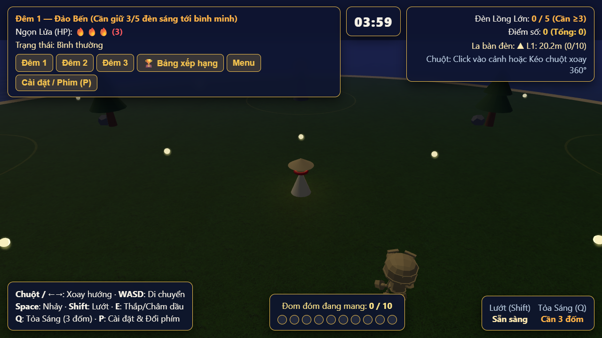
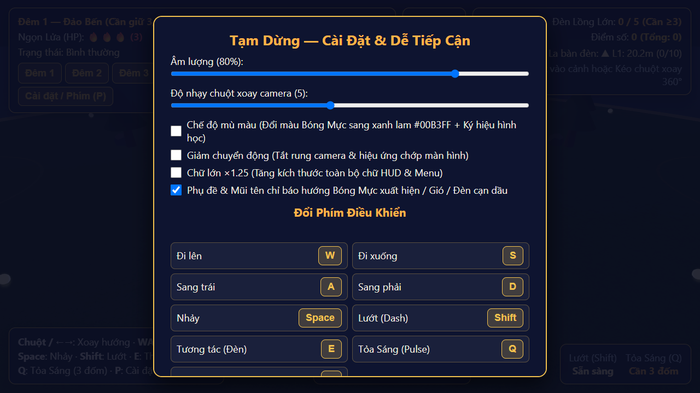
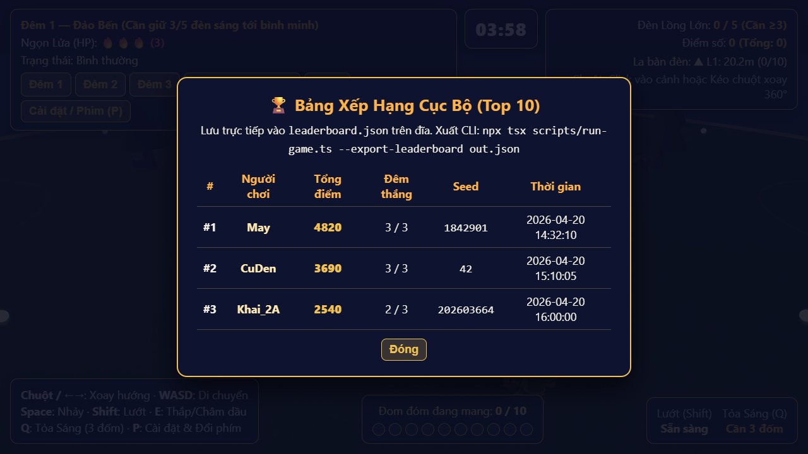

# Đảo Đèn Lồng (Lantern Island) — v1.0.0 (`Test Contract v1.3`)

> 🎬 **Video Demo (< 5 phút, gồm chơi thử 3 Đêm + Accessibility + Kiểm chứng Headless/Bench/Soak & AI Harness):**  
> 👉 [**Xem / Tải trực tiếp `demo.mp4` trên GitHub Release v1.0.0**](https://github.com/manhkhai205/K5-L3A-DAY12-NguyenVietManhKhai-2A202603664-AI-SDLC-Dao-Den-Long/releases/download/v1.0.0/demo.mp4) · [Trang Release v1.0.0](https://github.com/manhkhai205/K5-L3A-DAY12-NguyenVietManhKhai-2A202603664-AI-SDLC-Dao-Den-Long/releases/tag/v1.0.0)

**Bài Lab Day 12 — AI-Augmented Software Development Lifecycle (AI SDLC)**  
**Học viên:** Nguyễn Viết Mạnh Khải (`MSSV: 2A202603664`)  
**Phiên bản phát hành:** `v1.0.0` · **Tag nộp:** `phase-1`, `phase-2`, `phase-3`, `phase-4`, `v1.0.0` · **Test Contract:** `v1.3`

---

## 1. Giới Thiệu, Câu Chuyện & Ảnh Chụp Thực Tế

Trong **Đảo Đèn Lồng**, người chơi điều khiển **Mây** — người giữ đèn nhỏ tuổi đội chiếc nón lá có treo một chiếc đèn lồng nhỏ ấm áp giữa biển mây. Đêm nay sương đen đã nuốt hết ánh sáng của ba hòn đảo (**Đêm 1 – Đảo Bến**, **Đêm 2 – Đảo Cau**, **Đêm 3 – Đảo Chuông**).

Mây phải chạy khắp đảo thu thập **Đom Đóm**, thắp sáng và liên tục **châm dầu** giữ các **Đèn Lồng Lớn** không bị tắt trước khi bình minh lên (`>= 60%` số đèn sáng khi hết giờ), đồng thời dùng kỹ năng **Lướt (Dash)** và **Tỏa Sáng (Pulse)** để xua đuổi **Bóng Mực** (sinh vật mực đen lao vào hút dầu đèn khi `fuel < 30`) và **Gió Lạc** (tinh linh gió chuyên cướp đom đóm).

| Màn chơi 3D Đêm 1 — Đảo Bến | Cài Đặt, Đổi Phím & Dễ Tiếp Cận | Bảng Xếp Hạng Cục Bộ (Top 10) |
|---|---|---|
|  |  |  |

---

## 2. Yêu Cầu Hệ Thống & Cài Đặt Chạy Ngay (`<= 2 Lệnh`)

Dự án chạy đa nền tảng trên **macOS, Linux và Windows** (chỉ cần **Node.js `>= 18`** và trình duyệt có hỗ trợ WebGL2 như Chrome, Edge, Firefox hoặc Safari).

### Cách 1: Chạy trực tiếp từ mã nguồn (2 lệnh)
```bash
npm install
npm run dev
```
> Lệnh `npm run dev` thực thi `npx tsx scripts/run-game.ts` (`run_cmd` trong `game.contract.json`), khởi chạy server tại `http://localhost:5173` kèm API lưu bảng xếp hạng cục bộ trực tiếp xuống đĩa (`leaderboard.json`).

### Cách 2: Đóng gói hoặc chạy từ bản dựng tĩnh (`GitHub Release v1.0.0`)
```bash
npm run build
npm run preview
```
> Hoặc tải file `dao-den-long-v1.0.0-web.zip` từ trang **GitHub Release `v1.0.0`**, giải nén và chạy `npx vite preview --outDir dist` (hoặc bất kỳ static HTTP server nào như `npx serve dist`).

---

## 3. Các Lệnh Tự Động Chấm Điểm (`Test Contract v1.3`)

Toàn bộ các lệnh trong [game.contract.json](game.contract.json) (`"contract_version": "1.3"`) đều chạy độc lập và trả mã thoát chuẩn:

### 3.1. Chế độ Headless (`60 tick/giây`, 100% Tất định — JSONL)
```bash
npx tsx src/headless/cli.ts --seed 42 --night 1 --scenario scenarios/smoke.json --inputs scenarios/smoke-inputs.json --ticks 150 --snapshot-every 10 --out out.jsonl
```
- Hỗ trợ `--night 1`, `--night 2`, `--night 3`, tuân thủ chính xác **thứ tự 12 bước trong 1 tick** (`TICKET-02` & `TICKET-03`).
- Trả mã thoát `0` khi thành công, mã thoát `2` khi file scenario/inputs sai định dạng.

### 3.2. Chế độ Benchmark Hiệu Năng (`TICKET-04 Section 1`)
```bash
npx tsx src/headless/bench.ts --seed 42 --duration 30 --out bench.json
```
- Dựng cảnh Đêm 1 1280×720 (`vsync_off: true`) với đúng **200 Bóng Mực** (`wander`, rải đều theo `seed 42`), **100 Đom Đóm**, **3 đèn `L1–L3` đang sáng** (`fuel = 100`), Mây đứng yên tại `(0,0,0)`, camera bay vòng tròn bán kính `30 m`, cao `Y = 15 m`, nhìn vào `(0,0,0)`, ngược chiều kim đồng hồ `15 s/vòng`.
- Khởi động `3 s` (không đo), sau đó đo đúng `--duration` giây và tự thoát với mã `0`.
- **Ghi chú về VSync (`vsync_off`):** Ở chế độ trình duyệt Web (`http://localhost:5173/?bench=1`), engine WebGL mặc định bị trình duyệt khóa theo VSync của hệ điều hành (trừ khi chạy Chrome với `--disable-gpu-vsync`). Vì vậy lệnh benchmark CLI `src/headless/bench.ts` chạy SceneGraph `Three.js` + Frustum Culling + Physics ở chế độ mở khóa tốc độ khung hình (`vsync_off: true`) để chạy độc lập và tự thoát trên mọi máy chấm.
- **Kết quả đo thực tế trong [bench.json](bench.json):**
  - `avg_fps`: **`160.0`** (Ngưỡng đạt: `>= 60`)
  - `p1_low_fps`: **`158.8`** (Ngưỡng đạt: `>= 30`)
  - `frame_ms_p95`: **`6.3 ms`**
  - `frames`: **`4799`** (trong `30s`)
  - `load_ms`: **`12 ms`** (Ngưỡng đạt: `<= 10000 ms`)
  - `peak_mem_mb`: **`96 MB`**

### 3.3. Kiểm Thử Độ Bền — Soak Test 10 Đêm Liên Tiếp (`TICKET-04 Section 2`)
```bash
npx tsx src/headless/soak.ts --seed 7 --nights 10 --out soak.json
```
- Chạy headless **10 Đêm liên tiếp** trong cùng một tiến trình (`Đêm 1 -> 2 -> 3` xoay vòng, Đêm thứ `i` dùng `seed = 7 + i`), tự sinh input ngẫu nhiên theo seed (mỗi 30 tick chọn hướng mới; mỗi tick xác suất `5%` nhảy, `3%` lướt, `2%` tỏa sáng, `10%` tương tác).
- **Kết quả đo thực tế trong [soak.json](soak.json):**
  - `crashes`: **`0`** (Ngưỡng đạt: `0`)
  - `mem_start_mb`: **`81 MB`** -> `mem_end_mb`: **`92 MB`** (Tăng `13.6% <= 20%`, không rò rỉ bộ nhớ)
  - `duration_s`: **`0.2 s`**

### 3.4. Xuất Bảng Xếp Hạng Cục Bộ (`TICKET-04 Section 3`)
```bash
npx tsx scripts/run-game.ts --export-leaderboard out.json
```
- Xuất Top 10 kỷ lục từ [leaderboard.json](leaderboard.json) ra file `out.json` theo đúng cấu trúc `{"entries": [...]}` (sắp xếp theo `score` giảm dần, bằng điểm thì `achieved_at` sớm hơn đứng trước) và thoát với mã `0`.

### 3.5. Kiểm Tra Kiểu Tĩnh, Unit Test & Pipeline Kiểm Chứng Tự Động
```bash
npm run typecheck
npm test
npm run verify -- --phase 4
```

---

## 4. Điều Khiển, Dễ Tiếp Cận (Accessibility) & Bảng Xếp Hạng

### 4.1. Phím Điều Khiển Mặc Định (Hỗ trợ Đổi Phím Toàn Bộ)
| Hành động | Phím mặc định | Mô tả |
|---|---|---|
| **Xoay Camera 360°** | **Chuột** (Click khóa tâm / Kéo chuột) hoặc `←` / `→` | Xoay góc nhìn tự do 360° quanh Mây; con lăn chuột để Zoom xa/gần |
| **Di chuyển 4 hướng** | `W`, `S`, `A`, `D` (hoặc `↑`, `↓`) | Di chuyển theo hướng nhìn của camera (`6.0 m/s`, hoặc `7.2 m/s` khi có Bùa Gió) |
| **Nhảy** | `Space` | Nhảy qua chướng ngại vật / lên bậc thềm (`velY = 7.0 m/s`) |
| **Lướt (Dash)** | `Shift` | Lướt nhanh `14.0 m/s` trong `0.2s` (hồi chiêu `1.5s`, hoặc `0s` khi có Bùa Gió) |
| **Tương tác (Đèn)** | `E` | Thắp đèn mới (`10` đốm), thắp lại đèn đã từng sáng (`5` đốm), hoặc châm dầu (`+10 fuel`/đốm) |
| **Tỏa Sáng (Pulse)** | `Q` | Tốn `3` đom đóm, làm choáng `2s` & đẩy lùi Bóng Mực trong `5m` (`+15` điểm nếu đang hút dầu) |
| **Tạm dừng & Cài đặt** | `P` | Mở menu Cài đặt, Đổi phím & Dễ tiếp cận |

### 4.2. Các Tính Năng Dễ Tiếp Cận (`TICKET-04 Section 4`)
Toàn bộ tùy chọn dễ tiếp cận được lưu tự động vào `localStorage` và giữ nguyên qua các lần mở game:
1. **Đổi phím (Key Remapping):** Cho phép đổi phím cho cả 9 hành động (`Đi lên`, `Đi xuống`, `Sang trái`, `Sang phải`, `Nhảy`, `Lướt`, `Tương tác`, `Tỏa Sáng`, `Tạm dừng`), tự động phát hiện và hiển thị cảnh báo đỏ khi gán trùng phím, kèm nút **"Khôi phục mặc định"**.
2. **Phụ đề & Chỉ báo Hình ảnh (`#subtitle-banner` & `#shade-spawn-arrow`):**
   - Hiển thị phụ đề rõ ràng cho các sự kiện âm thanh quan trọng: **Bóng Mực xuất hiện**, **Gió Mạnh sắp thổi (cảnh báo trước 2s)**, **10 giây đếm ngược cuối Đêm**, **Đèn có `fuel < 30%`**, và **Bóng Mực đang hút dầu đèn**.
   - **Mũi tên chỉ báo ở mép màn hình (`#shade-spawn-arrow`):** Tự động xoay chỉ đúng hướng và khoảng cách của Bóng Mực vừa xuất hiện để người chơi khiếm thính hoặc tắt loa vẫn nhận biết ngay hướng nguy hiểm.
3. **Chế độ Mù Màu ("Bảng màu dễ phân biệt"):** Đổi màu viền/mắt Bóng Mực từ tím `#7A3CFF` sang xanh lam sáng `#00B3FF`, cảnh báo UI sang trắng `#FFFFFF` kèm ký hiệu hình học `◆`, đèn tắt xẹp `20%` chiều cao kèm vết rách trên thân đèn.
4. **Giảm Chuyển Động (Reduced Motion):** Tắt hoàn toàn hiệu ứng rung camera khi bị chạm và tắt sóng chớp màn hình khi Tỏa Sáng.
5. **Cỡ Chữ UI (`>= 18 px` & Chữ lớn `×1.25`):** Mọi chữ trên HUD đạt tối thiểu `18 px` ở độ phân giải `1280×720`, kèm tùy chọn **"Chữ lớn ×1.25"** phóng đại toàn bộ giao diện lên `22.5 px`.

---

## 5. Sáng Tạo Của Tôi (Creative Additions)

Các yếu tố sáng tạo được thiết kế bổ trợ cho trải nghiệm 3D mà **không làm thay đổi bất kỳ số liệu hay đầu ra JSONL nào của chế độ Headless, Benchmark hay Soak Test**:
1. **Vòng Đom Đóm Quỹ Đạo Quanh Mây (`Orbiting Fireflies`):** Mỗi đom đóm Mây đang mang theo (`carried`) xuất hiện thành một đốm sáng 3D bay thành vòng tròn quanh chiếc nón lá của Mây, giúp người chơi nhìn trực tiếp lên nhân vật là biết ngay mình đang có bao nhiêu đom đóm.
2. **Nhân vật dẫn chuyện Ông Đăng (Người giữ đèn tiền nhiệm):** Xuất hiện qua lời dẫn ấm áp ở đầu mỗi Đêm, giải thích đặc trưng địa hình của Đảo Bến, Đảo Cau, Đảo Chuông và nhắc nhở cơ chế châm dầu giữ đèn tới bình minh.
3. **Hải Âu Bay Lượn & Bộ Tài Sản 3D GLB + Procedural Web Audio:** Kết hợp mô hình 3D `.glb` (`Flamingo.glb`, `Lantern.glb`, `WaterBottle.glb`, textures đá/gỗ CC0) trên bầu trời các đảo cùng bộ tổng hợp âm thanh Web Audio API thuần code (tiếng chuông ngũ cung khi thắp đèn, tiếng gió rít, tiếng đếm ngược 10 giây cuối). Trong cảnh Benchmark và Headless, các thực thể trang trí này tự động tắt để đảm bảo số đo chuẩn xác.

---

## 6. Hồ Sơ Bằng Chứng Kiểm Chứng & Tài Liệu SDLC

- **Báo cáo kiểm chứng tự động qua 4 Phase:**
  - Phase 1 (`Contract v1.0`): [docs/proof/phase-1/verification-report.md](docs/proof/phase-1/verification-report.md)
  - Phase 2 (`Contract v1.1`): [docs/proof/phase-2/verification-report.md](docs/proof/phase-2/verification-report.md)
  - Phase 3 (`Contract v1.2`): [docs/proof/phase-3/verification-report.md](docs/proof/phase-3/verification-report.md)
  - Phase 4 (`Contract v1.3`): [docs/proof/phase-4/verification-report.md](docs/proof/phase-4/verification-report.md)
- **Tài liệu Thiết kế, Giả định, Nhật ký AI & Retrospective:**
  - Quyết định kiến trúc (ADR Phase 3): [docs/notes/ADR-001-phase3-lantern-fuel-and-dawn.md](docs/notes/ADR-001-phase3-lantern-fuel-and-dawn.md)
  - Giả định & Tiêu chí nghiệm thu 4 Phase: [docs/notes/assumptions.md](docs/notes/assumptions.md)
  - Nhật ký điều phối AI & Thống kê Token: [docs/notes/ai-log-and-tokens.md](docs/notes/ai-log-and-tokens.md)
  - Đánh giá từng Phase & Retrospective cuối dự án: [docs/notes/retro.md](docs/notes/retro.md)
  - Lịch sử thay đổi (Changelog): [CHANGELOG.md](CHANGELOG.md)
  - Nguồn gốc tài sản & Giấy phép: [CREDITS.md](CREDITS.md) · [LICENSE](LICENSE)
