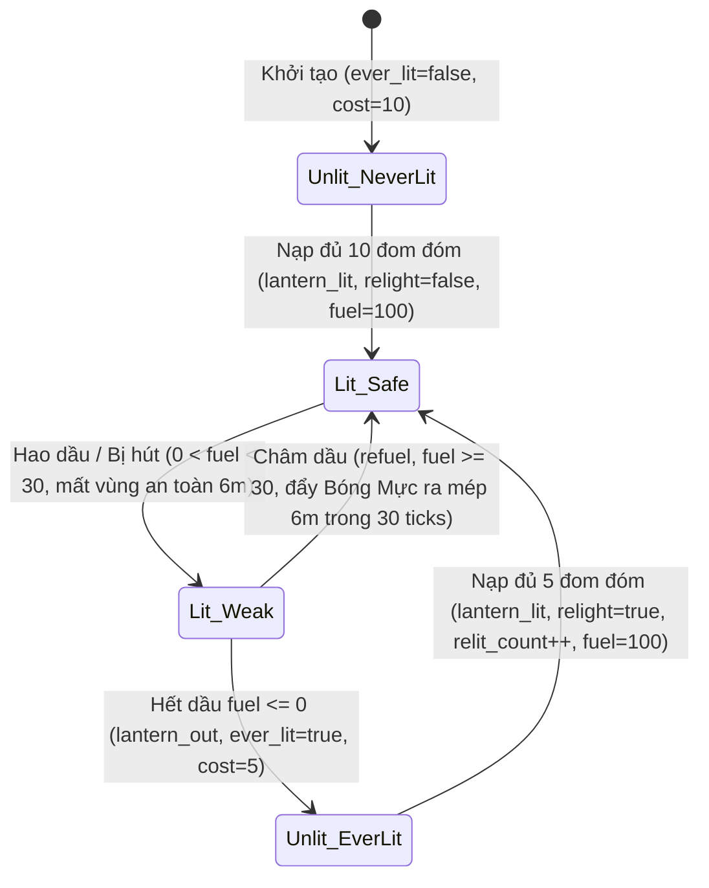

# ADR-001: Chuyển Đổi Mô Hình Trạng Thái Đèn (Nhiên Liệu 1/60) & Luật Thắng Bình Minh (Phase 3 — TICKET-03)

- **Trạng thái:** Đã chấp thuận & Triển khai (Phase 3 — `tag: phase-3`)
- **Ngày:** 2026-11-20
- **Liên quan:** `TICKET-03` ("Đèn cạn dầu") & `Test Contract v1.2`

---

## 1. Bối cảnh & Vấn đề (Context)

Ở Phase 1 (`PRD-0`) và Phase 2 (`TICKET-02`), Đèn Lồng Lớn hoạt động theo mô hình trạng thái một chiều:
- Đèn tắt (`lit: false`) nhận đủ `10` đom đóm sẽ chuyển sang sáng vĩnh viễn (`lit: true`), không nhận thêm đom đóm, và tạo vùng an toàn cố định `6m`.
- Trận đấu kết thúc thắng ngay lập tức khi toàn bộ đèn trên đảo được thắp sáng (`reason: "all_lit"`).

Tuy nhiên, qua playtest, người chơi giỏi có thể thắp hết đèn chỉ trong ~2 phút, làm mất sự kịch tính ở cuối Đêm. `TICKET-03` đưa ra Change Request thay đổi 3 luật cốt lõi:
1. **Đèn có nhiên liệu (`fuel` tối đa `100`):** Tự hao `1.0/s`, có thể châm thêm dầu (`refuel`), tắt khi `fuel <= 0` (`lantern_out`), và thắp lại chỉ tốn `5` đom đóm (`ever_lit: true`, `relight_cost: 5`).
2. **Bóng Mực hút dầu (`drain`):** Khi đèn có `fuel < 30`, đèn mất vùng an toàn `6m`. Bóng Mực ở trạng thái `wander` sẽ ưu tiên tìm tới đèn sáng có `fuel < 30` gần nhất, đứng ở khoảng cách `<= 2m` và hút `5 fuel/s` (`fuel_drain` ghi mỗi 60 tick).
3. **Luật thắng Sống Sót Tới Bình Minh (`dawn_survived`):** Không còn thắng sớm khi thắp hết đèn; người chơi chỉ thắng khi còn sống lúc hết giờ (`time_left_s == 0`) và số đèn đang sáng `>= ceil(0.6 * totalLanterns)`.

---

## 2. Quyết định Thiết kế (Decisions)

### A. Biểu diễn Nhiên Liệu bằng Số Nguyên `1/60` (`fuelUnits`)
- **Vấn đề:** Nếu lưu `fuel` bằng số thực dấu phẩy động (`float`) và trừ `1/60` (`0.0166666...`) mỗi tick, sai số tích lũy IEEE-754 sau hàng nghìn ticks sẽ làm lệch thời điểm đèn tắt (`fuel <= 0`) hoặc lệch sự kiện `fuel_drain` giữa các máy.
- **Quyết định:** Trong `LanternSim` (`src/core/types.ts`), lưu nhiên liệu bằng số nguyên `fuelUnits` với hệ số `FUEL_UNITS_PER_FUEL = 60` (`fuel = 100` tương ứng `fuelUnits = 6000`).
  - Mỗi tick ở **Bước 2**, đèn đang sáng trừ đúng `1` đơn vị tự hao + `5` đơn vị cho mỗi Bóng Mực đang ở trạng thái `drain` trong bán kính `2m`.
  - Ngay sau Bước 2, nếu `fuelUnits <= 0`, đèn chuyển sang `lit = false`, `deposited = 0`, `everLit = true`, và phát sự kiện `lantern_out`.
  - Chỉ khi xuất ra JSONL (`snapshot`, `refuel`, `fuel_drain`), giá trị mới được chia cho `60` và làm tròn 1 chữ số thập phân (`round1(fuelUnits / 60)`).

### B. Mở rộng Máy Trạng Thái Đèn & Tương Tác (`Step 5`)

### C. Mở rộng Máy Trạng Thái Bóng Mực (`drain`) & Luật Thắng/Điểm (`Step 11`)
- Bổ sung trạng thái `drain` và bộ đếm `drainTicks` vào `ShadeSim`.
- Bỏ điều kiện thắng sớm `every(l => l.lit)` ở Bước 11. Thay bằng kiểm tra khi `timeLeftTicks <= 0`: nếu `litLanterns.length >= Math.ceil(0.6 * lanterns.length)` thì thắng với `reason: "dawn_survived"` và cộng điểm thưởng bình minh (`+50 + floor(fuel)` cho mỗi đèn sáng, `+50` cho mỗi Ngọn Lửa còn lại).

---

## 3. Hệ quả & Cập nhật Kiểm thử (Consequences)

- **Cập nhật Test cũ có ghi lý do:** Bài test `scenarios/smoke.json` (thắp đủ 5 đèn ở tick 101) không còn kết thúc game ở tick 101 mà tiếp tục ở trạng thái `'playing'` với `player.capacity = 12` và `score = 150`. Đã cập nhật assertion và ghi chú rõ lý do trong `tests/core.test.ts`.
- **Thêm 3 Scenarios mới cho Phase 3:** `p3-fuel-relight.json`, `p3-shade-drain.json`, `p3-dawn-win.json` kiểm chứng toàn diện các luật mới.
